<!--
  The cards are SVGs built by scripts/build.mjs from scripts/content.mjs.
  The dashboard's numbers are refreshed daily by .github/workflows/cards.yml.
  Each card has a light twin in assets/light/, picked by the viewer's GitHub theme.
-->

<picture>
  <source media="(prefers-color-scheme: light)" srcset="./assets/light/hero.svg" />
  
</picture>
  

<picture>
  <source media="(prefers-color-scheme: light)" srcset="./assets/light/about.svg" />
  
</picture>
  

<picture>
  <source media="(prefers-color-scheme: light)" srcset="./assets/light/stack.svg" />
  
</picture>
  

<picture>
  <source media="(prefers-color-scheme: light)" srcset="./assets/light/dashboard.svg" />
  
</picture>
  

## 🚀 Featured work

| Project | What it is | Built with |
| :-- | :-- | :-- |
| [**KeepSafe**](https://keepsafe-t2m.pages.dev) [Live&nbsp;app](https://keepsafe-t2m.pages.dev)&nbsp;·&nbsp;private&nbsp;repo | A vault for API keys and credentials that also watches the providers behind them: usage, cost, quota and uptime, with alerts. |  |
| [**AI&nbsp;Resume&nbsp;Analyzer**](https://github.com/rahulsharma1919/ai-resume-analyzer) [Live&nbsp;demo](https://ai-resume-analyzer-psi-ivory.vercel.app)&nbsp;·&nbsp;[Code](https://github.com/rahulsharma1919/ai-resume-analyzer) | Upload a resume, get an ATS score, then see the weak sections and the fixes that raise it, analysed by Puter.js AI. |  |
| [**Bharat&nbsp;Darshan**](https://github.com/rahulsharma1919/Bharat-Darshan) In&nbsp;progress&nbsp;·&nbsp;[Code](https://github.com/rahulsharma1919/Bharat-Darshan) | Explore India's places, culture and food, then book a tour. A dashboard keeps bookings, tickets, favourites and orders. |  |
| [**Dodong&nbsp;Consultancy**](https://github.com/rahulsharma1919/Freelance-project) Freelance&nbsp;·&nbsp;[Code](https://github.com/rahulsharma1919/Freelance-project) | A responsive marketing site for a web and app development consultancy: services, success stories, why choose us and a contact section. |  |

 

<!-- 3D contribution city: generated by .github/workflows/profile-3d.yml into the `profile-3d` branch -->
<picture>
  <source media="(prefers-color-scheme: light)" srcset="https://raw.githubusercontent.com/rahulsharma1919/rahulsharma1919/profile-3d/profile-crimson-light.svg" />
  
</picture>
  

<picture>
  <source media="(prefers-color-scheme: light)" srcset="./assets/light/connect.svg" />
  
</picture>

  
  
  
  
  

  

<picture>
  <source media="(prefers-color-scheme: light)" srcset="./assets/light/footer.svg" />
  
</picture>

